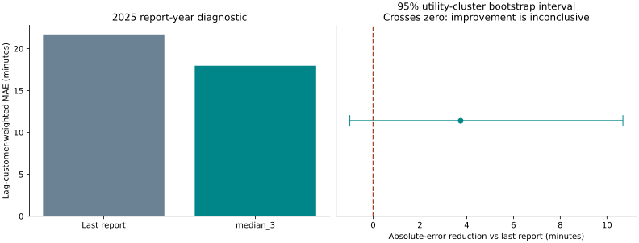
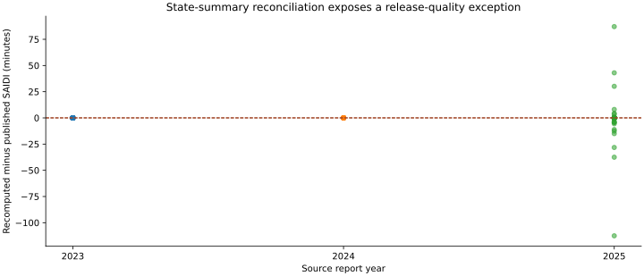

# Utility Reliability Due Diligence Lab

**A source-audited analyst workbench that distinguishes a newer dataset, a better-looking model and a defensible decision.**

Electric utilities · Economic research · Business analysis · Consulting due diligence

## Start here

1. Download [`outputs/workbench.html`](outputs/workbench.html) using GitHub's **Download raw file** control, then open it locally. It is self-contained and works without a server, credentials or internet.
2. Filter utilities by state, ownership or name. Inspect peer cohorts, source rows, data flags and six-year history.
3. Change the clearly labeled reduction, outage-value, cost and discount assumptions to calculate a conditional social-value threshold.
4. Read the [executive memo](outputs/executive_memo.md), [methodology](METHODOLOGY.md), [open-issue register](ISSUES.md) and [verification evidence](verification.json).

The application is delivered as an offline/local tool. It is not hosted as a live public website. The separate `flagship-browser-acceptance` CI job exercises both API and offline deliveries in Chromium, Firefox and WebKit on desktop and mobile viewports. Consult its actual result at the commit being reviewed; [browser acceptance documentation](BROWSER_ACCEPTANCE.md) describes the checks and remaining limits.

## Actual scope

- **Six official EIA workbooks**, 2020–2025, with hashes and original workbook files.
- **11,552 normalized method-specific records**, covering **1,010 utility-state keys**.
- IEEE and Other reporting methods separated; blanks remain missing, never zero.
- Original workbook, sheet and row lineage retained for every normalized record.
- A SQLite warehouse, customer-weighted SQL aggregation, peer-cohort review, historical reporting-method checks and a balanced-panel sensitivity analysis.
- Report-year-separated model selection, calibration and diagnostic testing, with **675-utility cluster bootstrap** uncertainty.
- A local read-only HTTP API plus an equivalent offline workbench.

## The important findings are decision gates

**Newer does not automatically mean usable.** All 51 available state summaries in each of 2023 and 2024 reconcile within the configured 0.11-minute tolerance. **Twenty-six 2025 state summaries do not.** Their differences are retained, not overwritten or attributed to a presumed cause. The complete 2025 release is excluded from decision inputs; the workbench defaults to the **2024 reconciled release**.

**A better point estimate is not sufficient evidence to promote a model.** The three-report median has 2025 diagnostic weighted MAE of **17.97 minutes**, versus **21.71** for the last-report baseline. However, the 95% utility-cluster bootstrap interval for error reduction is **[-1.00, 10.68] minutes**, crossing zero, and the nominal 90% band covers **88.28%** of observations. The predictive promotion gate fails. That diagnostic also uses a quarantined source year, reinforcing its exploratory status.





## Reproduce the analysis

Python 3.10+ recommended; dependencies are pinned in `requirements.txt`.

```bash
python -m pip install -r requirements.txt
python verify.py
```

`verify.py` reads the bundled official XLSX files, rebuilds the panel and every derived artifact, executes 17 tests, independently checks all original source cells, reconciles SQL totals, and checks a clean byte-identical regeneration. It does not download fresh data or silently change source versions.

For the optional local API/server:

```bash
python app.py --port 8765
```

Then open `http://127.0.0.1:8765`. It binds to localhost, has read-only routes, and exposes no accounts or uploads. Alternatively, the offline HTML requires none of these steps.

To refresh official data intentionally, run `python acquire.py`, review the new source hashes and issues, and rerun verification. Acquisition downloads full source ZIPs into `data/raw`; those ZIPs are excluded from Git. Original reliability workbooks and their hashes are versioned. A source update requires human assessment of release reconciliation before a newer year enters the decision view.

## What this demonstrates

This is a stronger research-and-analytics portfolio case than the earlier ten-district simulation: it works through source-schema changes, data lineage, denominator consistency, peer definitions, reporting-method changes, clustered uncertainty, release quarantine, promotion gates and a usable analyst interface. It does not manufacture observed project savings from assumed effectiveness.

It remains an independent **research prototype**, not proof of 8–10 years of work experience, production certification or engineering expertise. See [CANDID_ASSESSMENT.md](CANDID_ASSESSMENT.md) for the evidence it demonstrates and the gaps that remain.

## Sources and license

U.S. Energy Information Administration, [Form EIA-861 detailed data](https://www.eia.gov/electricity/data/eia861/), official 2020–2025 reliability schedules, downloaded October 18, 2026. Exact URLs and ZIP/workbook SHA-256 hashes are in `data/source_manifest.json` and `data/workbook_manifest.json`. Government data retain their attribution; original code is MIT licensed. No EIA or utility endorsement is implied.
