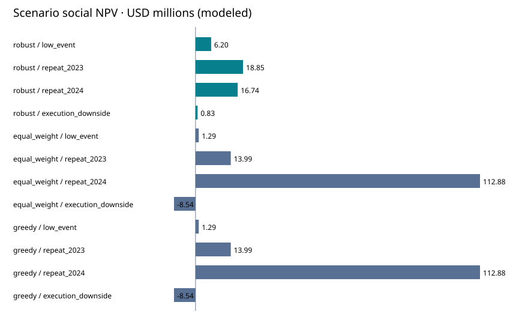

# Grid Resilience Capital Allocation

**A $20 million investment-committee case: fund the upgrades that preserve value under uncertainty, and leave capital uncommitted when more spending worsens the downside.**

Electric utilities | Business analysis · Economic research · Consulting · Capital planning

## Decision and result

The exact optimizer considers **59,049 allocations** across ten hypothetical districts. Under the pinned assumptions, it reserves **$7.716 million**, chooses **three upgrades**, uses **five crew units**, and serves **two designated critical-service districts**. Its worst specified scenario produces **$0.827 million of modeled social NPV**, versus **-$8.539 million** for the equal-weight optimized and simple greedy portfolios. A harsher outside-set stress still produces **-$6.316 million**. Robustness is limited to the chosen uncertainty set.



**Observed inputs:** EIA state electricity-reliability benchmarks for 2024 and 2023. **Hypothetical inputs:** service districts, customers, critical-service designations, costs, effects and valuation. These are not actual utility investment recommendations, employer outcomes or feeder outage forecasts. The objective is customer/social value, not utility cash profit.

## Review the work

- [Executive decision memo](outputs/executive_memo.md)
- [Selected allocation](outputs/selected_portfolio.csv)
- [Scenario comparison and regret](outputs/policy_comparison.csv)
- [Budget frontier](outputs/budget_frontier.csv)
- [Assumption sensitivity](outputs/valuation_sensitivity.csv)
- [Data-completeness sensitivity](outputs/coverage_sensitivity.json)
- [Three-stage verification evidence](verification.json)
- [Business requirements and method](METHODOLOGY.md)

Download `outputs/report.html` and open it locally for the complete styled investment-committee report. It is a self-contained analytical report, not a hosted application.

## Reproduce

Python 3.10+; **standard library only**, no credentials or package installation.

```bash
python pipeline.py
python -m unittest -v
python verify.py
```

Run these commands from this directory. `verify.py` runs tests, checks all extracted source fields, independently reconciles financial accounting, verifies an optimization oracle, checks constraint feasibility and deletes/rebuilds outputs to compare SHA-256 hashes. No network is needed; the historical input snapshot is pinned.

## What makes the case substantive

This case converts an ambiguous allocation problem into an explicit objective and operational constraints; separates reported observations from assumptions; quantifies the price of different decision policies; tests both model uncertainty and data completeness; and provides an auditable recommendation with clear stage gates.

The primary maximin solver enumerates a finite set exactly. A separate dynamic-programming implementation independently checks the equal-weight objective, while hand-worked tests establish a known robust optimum. The model does not pretend that two annual state observations can support a credible machine-learning forecast.

## Scope and scalability

Ten districts and two intervention choices yield 3^10 allocations. Exact enumeration establishes global optimality for this finite instance, but scales exponentially. For hundreds of districts, use a validated mixed-integer optimization formulation and record solver status, gap and time limits. Site-level project dependencies, cross-district outage correlations and overlapping upgrades require engineering data and a richer formulation.

Designed to demonstrate business cases, economic modeling, requirement gathering, SQL reporting, tradeoff analysis and executive communication found in the user-supplied Ketjen, Wells Fargo and Oracle descriptions. It does not demonstrate Java/C++, SCADA, power-flow engineering or professional tenure.

## Source and reuse

[EIA Electric Power Annual, Table 11.2](https://www.eia.gov/electricity/annual/html/epa_11_02.html), IEEE method, 2024/2023 historical snapshot retrieved October 17, 2026. Original selected rows, parsing indices, source URL and hash are bundled. This is a historical case, not a claim of the latest release. EIA numbers and hypothetical investment inputs are identified separately. Original code is MIT licensed; EIA data retain their source attribution.
