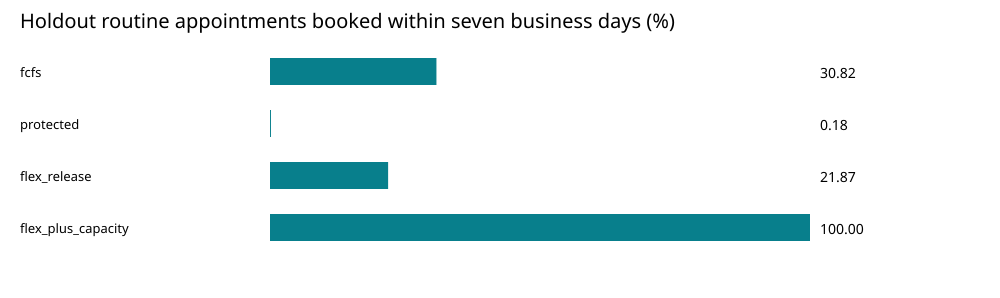

# Outpatient Access & Capacity Simulation

**Before funding a scheduling change, compare access, staff capacity and financial tradeoffs under repeatable demand pressure.**

Healthcare operations | Business analysis · Consulting · Process improvement

This is a complete synthetic planning case, not a patient-facing scheduling tool. It compares FCFS, protected urgent slots, flexible release and flexible release with four extra staffed slots/day. Ten development replications select a policy; thirty separate holdout replications evaluate it, followed by thirty stress replications.



## Decision-ready findings

Under the pinned assumptions, **flexible release plus additional capacity** is the only development policy meeting both 90% booking targets. On holdout replications, approximately **99.99%** of urgent requests are booked within one business day, and **100%** of routine requests within seven business days. These are simulated results, not observed patient outcomes.

The policy costs **$53,600** more over the evaluation window under the assumed cost inputs. It buys faster access, not additional eventual completed visits: this model has no abandonment, wait-dependent attendance or cancellation response, and the drain horizon lets the evaluation cohort finish under every policy. This limitation is central to the financial interpretation. Service access is not equivalent to clinical outcomes or profitability.

## Review

- [Executive decision memo and personal understanding](outputs/executive_memo.md)
- [Development and holdout policy comparison](outputs/policy_summary.csv)
- [Paired holdout differences and economics](outputs/paired_holdout_comparison.csv)
- [Stress tests](outputs/stress_tests.csv)
- [Request-level audit sample](outputs/sample_request_outcomes.csv)
- [Data dictionary and decision design](METHODOLOGY.md)
- [Verification evidence](verification.json)

Download `outputs/report.html` and open locally for the styled report. Source publication does not host a live app.

## Reproduce

Python 3.10+, standard library only, no keys or network required.

```bash
python pipeline.py
python -m unittest -v
```

Run from this project directory. From the parent `2026-10-18` directory, `python verify_all.py` executes the three verification stages for both projects. Tests explicitly check capacity, reserved/public slot accounting, released slots, no-shows, censoring and deterministic request generation. GitHub CI runs the same verification.

## Why the work is substantive

The case distinguishes a scheduling policy from a staffing intervention; handles warmup, cohort follow-up and censoring; uses common random numbers for paired comparisons; keeps development and evaluation seeds separate; audits every booking against physical capacity; and refuses to hide a negative financial tradeoff behind a favorable access metric.

All requests and parameters are invented. No clinical urgency prediction, treatment decisions, actual patient data, clinician continuity or intraday service model are included. AHRQ guidance motivates measuring demand and available slots, but does not supply numerical calibration: [Open Access Scheduling](https://www.ahrq.gov/cahps/quality-improvement/improvement-guide/6-strategies-for-improving/access/strategy6a-openaccess.html), reviewed October 18, 2026.
