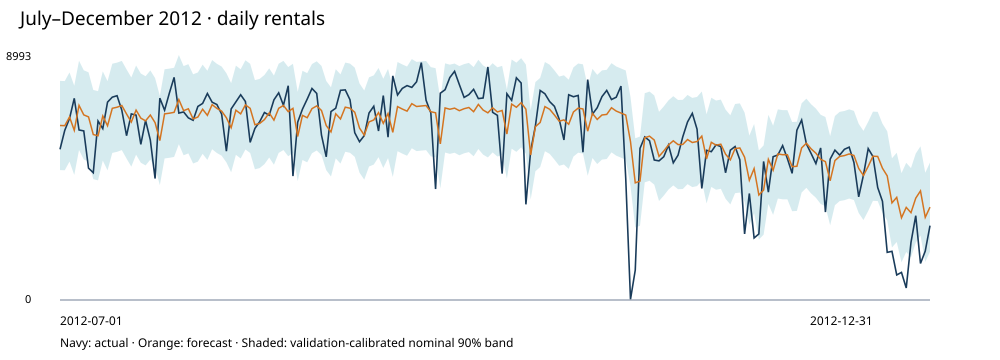

# Mobility Demand Forecasting & Capacity Economics

**Connect a forecast to an operating decision, while keeping future information out of the model.**

Urban mobility | Business analytics · Economic modeling · Demand planning

The case uses **731 public daily Capital Bikeshare observations**, compares five forecasting specifications, selects a model on a chronological validation period, and evaluates the subsequent **184-day test period** on accuracy, uncertainty and hypothetical capacity economics.



## Main findings

Validation selects the ridge model with penalty 1. Test weighted absolute percentage error is **13.35%**, versus **18.70%** for a seven-day seasonal-naive baseline. A nominal 90% validation-calibrated prediction band covers **87.5%** of test observations, so it is not presented as guaranteed future coverage.

Using invented shortfall and excess-capacity cost assumptions, the selected policy reduces modeled historical test cost by **$145,115** relative to a separately calibrated baseline capacity policy. This is a counterfactual trip-equivalent capacity calculation, not measured savings, physical fleet sizing or proof of an operational improvement.

## Review

- [Executive report and personal understanding](outputs/executive_memo.md)
- [Validation-only model selection](outputs/validation_model_selection.csv)
- [Test evaluation and capacity costs](outputs/test_evaluation.csv)
- [Prequential forecasts with training cutoffs](outputs/prequential_forecasts.csv)
- [Monthly drift monitor](outputs/monthly_drift_monitor.csv)
- [Cost sensitivity](outputs/cost_sensitivity.csv)
- [Data provenance and license](data/provenance.json)
- [Methodology and data dictionary](METHODOLOGY.md)
- [Verification evidence](verification.json)

Download `outputs/report.html` and open locally for the complete styled report. No live application hosting is implied.

## Reproduce

Python 3.10+, standard library only; pinned input CSV included.

```bash
python pipeline.py
python -m unittest -v
```

From the parent `2026-10-18` directory, run `python verify_all.py` for all three verification stages. No package installation, credentials or network are required. A small original ridge-regression implementation uses standardization and pivoted Gaussian elimination; hand-worked numerical and leakage tests are included.

## Why this is more than a prediction exercise

The project audits information timing, uses rolling one-day-ahead evaluation, separates validation from test-period decisions, compares against practical baselines, diagnoses interval undercoverage, converts residuals to an asymmetric-cost capacity rule, and measures model value in operational units with explicit limitations.

The output forecasts **realized rentals**, not uncensored demand. Capacity units are **trips/day**, not bikes. Weather observations, target components, station rebalancing and lost rentals cannot be silently assumed available. This is a historical 2011–2012 benchmark, not a current commercial forecast.

## Attribution and licensing

Fanaee-T, H. (2013). **Bike Sharing [Dataset]**. UCI Machine Learning Repository. DOI: [10.24432/C5W894](https://doi.org/10.24432/C5W894). Dataset licensed **CC BY 4.0**. Retrieved from the mirror identified in `data/provenance.json`; only line endings were normalized. Original model, analysis and report code are MIT licensed. This work is an independent adaptation; the dataset creators and operator do not endorse its conclusions.
