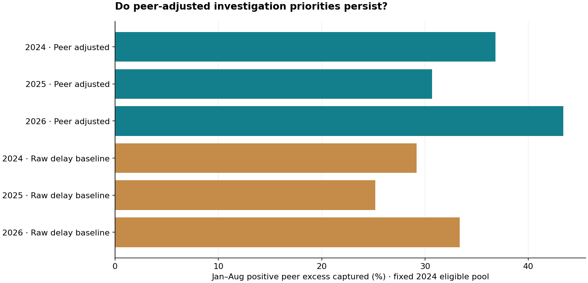

# Airline Delay Intervention Screen

**Where should an aviation diligence team spend ten investigation slots?**

US passenger airlines · Python · SQL · Peer benchmarking · Constrained prioritization · Retrospective validation

The project audits **60,093 official carrier-airport-month records**, January 2024–August 2026. It freezes an eligible cohort and investigation ranking from January–August 2024, checks 2025, and diagnoses January–August 2026 without retuning. The decision owner is an industry diligence team, not an airline claiming authority over competitors.

The fixed peer-adjusted queue captures **43.38%** of eligible positive peer excess in 2026 versus **33.34%** for the raw-delay baseline under identical ten-slot/two-per-airport limits. Its exploratory two-month-block interval for the capture difference is **5.94–13.07 percentage points**. **148 rows are quarantined**; strict/permissive sensitivities retain their effects visibly. The source cohort contains 550 sites; 533 have later peer-comparable observations.

This is a management investigation screen, not an estimate of avoidable delay. Schedule, aircraft and route differences remain; the prospective deployment gate is false. Historical release vintages are not reconstructed.



## Interactive workflow and reproduction

```bash
cd projects/2026-10-19/airline-delay-intervention-screen
python -m pip install -r ../requirements.txt
python ../collect.py --project airline-delay-intervention-screen
python pipeline.py
python verify.py
python ../serve.py --project airline-delay-intervention-screen
```

Open **http://127.0.0.1:8765/app.html**. The workbench filters carrier/airport sites, changes the investigation cap and policy, exposes missing diagnostic coverage, and prices explicitly hypothetical pilot assumptions. It validates inputs, recovers from errors, handles empty searches and resets to the published policy. It also works as a downloaded `app.html` plus `app.js` without a server. No public live hosting is claimed.

Collection uses official URLs and verifies pinned observations before analysis. Full raw sources and row-level exports are collected/generated locally; compact findings, code, source fingerprints and the application are published. New source observations cause an explicit failure rather than silent repinning. See [data reproduction](../DATA_REPRODUCTION.md).

## Review the evidence

- [Executive brief](outputs/executive_memo.md), [interactive app source](outputs/app.html), [review queue](outputs/investigation_shortlist.csv), [policy results](outputs/policy_evaluation.csv), [quarantine](outputs/quarantine.csv).
- [Methods/data dictionary](METHODOLOGY.md), [source manifest](data/source_manifest.json), [observation fingerprints](data/pinned_content.json), [candid assessment](CANDID_ASSESSMENT.md), [open issues](ISSUES.md).
- [Verification](verification.json), [test log](test_results.txt), [browser scope](VISUAL_REVIEW.md), [GitHub CI](https://github.com/Pratattack/analytics-portfolio/actions).
- [Resume bullets, personal explanation and five answered interview questions](INTERVIEW.md).

Python 3.12 recommended. Shared parent files are required; clone the repository. Analysis uses the standard library; pinned Matplotlib/NumPy render charts. CI checks clean collection/reproduction and Chromium/Firefox/WebKit desktop/mobile application flows. Source publication and a passing browser job do not establish production or operational readiness.

## Source and reuse

[BTS delay-causes export](https://www.transtats.bts.gov/ot_delay/ot_delaycause1.asp), original research snapshot October 19, 2026. The manifest preserves original archive/CSV hashes; the CSV fingerprint controls reproduction despite ZIP timestamp changes. Source definitions and operating-carrier keys are preserved; separate marketing-network totals are not appended. Government statistics retain BTS attribution. Original code is MIT licensed; no agency, airline or employer endorsement is implied.
