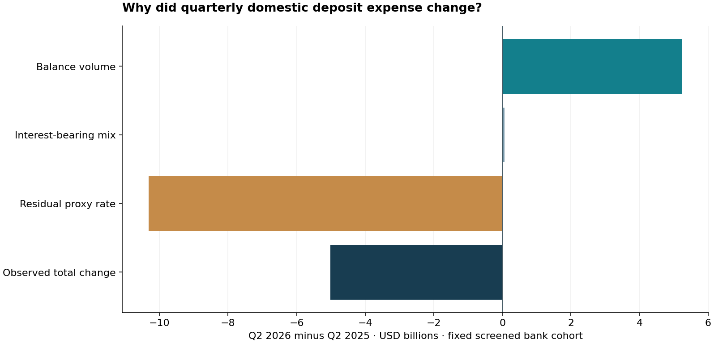

# Bank Deposit Cost Attribution

**Why did domestic deposit interest expense change: balance volume, interest-bearing mix, or a residual effective-rate component?**

US insured domestic banking · Economic research · Python · SQL · Exact interaction attribution · Funding tradeoffs

The empirical panel contains **48,814 FDIC bank-quarters across 11 quarter ends**, December 2023–June 2026. Its latest insured domestic-bank universe contains **4,238 institutions**. The intended users are banking economic researchers and treasury analysts; the measurable objective is a fully reconciled expense bridge with explicit coverage and selection sensitivity.

Across **4,018 screened banks**, Q2 domestic deposit interest expense fell **$5.012bn** between 2025 and 2026. Exact six-order Shapley attribution assigns **+$5.242bn** to volume, **+$0.057bn** to mix and **−$10.310bn** to the residual proxy-rate component. The cohort covers **90.96%** of latest domestic deposits; the broader matched cohort has a different **$3.810bn** decline. **89 bank-quarters are flagged**, not silently repaired.

The simple constant-mix/rate baseline applies prior-period mix and proxy rate to current average balances. It implies **$89.466bn** of quarterly expense versus **$78.903bn** observed in the screened cohort. This is an accounting counterfactual, not a validated forecast. The exact attribution is economic research, not causal econometrics: proxy rates use endpoint-average balances and absorb timing, acquisition and product effects.



## Interactive workflow and reproduction

```bash
cd projects/2026-10-19/bank-deposit-cost-attribution
python -m pip install -r ../requirements.txt
python ../collect.py --project bank-deposit-cost-attribution
python pipeline.py
python verify.py
python -m http.server 8765 --directory outputs
```

Open **http://127.0.0.1:8765/app.html**. The workbench separates observed research from a generic hypothetical repricing calculator. Change target balance/share, rate cut, attrition, replacement funding cost and fixed cost; inspect downside and break-even attrition. An asset-bucket filter applies only to the 20-bank review queue, clearly labeled separately from the 4,018-bank cohort. Input errors, recovery, filters and reset are tested in browser CI. No public live hosting is claimed.

Collection downloads official snapshots and compares canonical observations with pinned fingerprints. Full raw sources and detailed exports are collected/generated locally; compact findings, source fingerprints, code and the application are published. Metadata/compression changes do not silently change observations; changed observations fail closed. See [data reproduction](../DATA_REPRODUCTION.md).

## Review the evidence

- [Executive brief](outputs/executive_memo.md), [interactive app source](outputs/app.html), [review queue](outputs/review_queue.csv), [cohort exclusions](outputs/cohort_exclusions.csv), [quarterly flags](outputs/quarterly_flags.csv), [structural-break sensitivity](outputs/structural_break_sensitivity.csv).
- [Methods/data dictionary](METHODOLOGY.md), [source provenance](data/source_manifest.json), [observation fingerprints](data/pinned_content.json), [candid assessment](CANDID_ASSESSMENT.md), [issues](ISSUES.md).
- [Verification](verification.json), [test log](test_results.txt), [browser scope](VISUAL_REVIEW.md), [GitHub CI](https://github.com/Pratattack/analytics-portfolio/actions).
- [Two resume bullets, personal explanation and five answered interview questions](INTERVIEW.md).

Python 3.12 recommended. Clone the repository for shared parent files. Tests check every analytical source pointer, quarterly/YTD accounting, cohort partition and an independent closed-form Shapley oracle. The finite administrative panel does not justify a fabricated population-sampling interval; definition, cohort and behavioral uncertainty are addressed explicitly with sensitivity and adoption gates.

## Source and reuse

[FDIC BankFind API](https://api.fdic.gov/banks/docs/) and its official field dictionary; original research snapshot October 19, 2026. Source URLs, API counts/index vintage and original archive hashes are retained. The collector preserves actual received responses locally and verifies canonical observations. Government data retain FDIC attribution. Original code is MIT licensed; no FDIC, bank or employer endorsement is implied. The analysis is neither bank-safety scoring nor a real treasury pricing recommendation.
