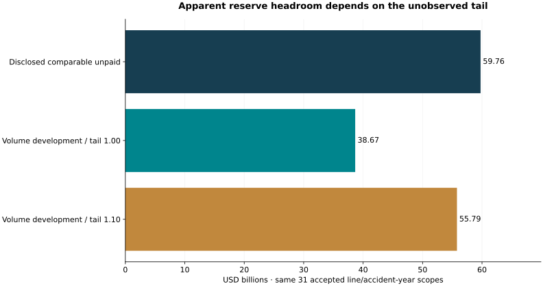

# Insurance Reserve Challenge Lab

**Decision owner:** a property-and-casualty insurer's finance / actuarial diligence committee.

**Question:** Do disclosed loss-development triangles justify a reserve challenge, and which line-level uncertainties should be investigated before discussing capital returns?

The objective is to trace every retained paid/incurred observation to its original filing, compare a development model with a simple benchmark on masked diagonals, and rank the dollar sensitivity of comparable unpaid balances. This is an independent research prototype, not an actuarial opinion or authorization to release reserves.

## Measured findings

- Six original 2025 annual filings yield **4,046 numeric paid/incurred cells and 48 disclosed triangles**.
- **31 triangles** pass the selected model gates; **17 remain excluded and inspectable**. Reasons include missing/consecutive-year support, decreasing or negative net cumulative paid values, an overlapping aggregate and insufficient history. Exclusion does not establish a source error.
- Across **468 masked one-step cells** in target valuation years 2023–2025, volume-development WAPE is **14.54%**, versus **44.50%** for repeating the last observed increment.
- Within the same accepted line/accident-year scopes, disclosed incurred-minus-paid is **$59.76bn**, compared with a default development unpaid estimate of **$38.67bn**. Raising the assumed tail factor from 1.00 to 1.10 adds **$17.12bn** to the modeled balance.

**Recommendation:** prioritize actuarial diligence around the largest tail-sensitive lines. The apparent difference is not evidence of excess capital: sparse oldest ages, settlement changes, omitted older claims/unallocated expenses, different disclosure horizons and tail assumptions limit interpretation. Predictive and capital-release promotion remain false.

## Explore

- [Executive evidence report](outputs/report.html)
- [Interactive workbench source](outputs/app.html): download with sibling `workbench.js`, or use the local server below.
- [Executive brief](outputs/executive_brief.md)
- [Line-level decision table](outputs/reserve_review.csv)
- [All triangle gates and exclusions](outputs/triangle_inventory.csv)
- [Original source lineage](outputs/source_lineage.csv)
- [Masked-diagonal diagnostic](outputs/masked_diagonal_diagnostic.csv)
- [Tail/method sensitivity](outputs/model_tail_sensitivity.csv)



GitHub displays HTML source rather than running an application. No hosted live-service URL is claimed.

## Reproduce

From the repository root:

```bash
python -m pip install -r projects/2026-10-20/requirements.txt
python projects/2026-10-20/verify_all.py
python projects/2026-10-20/serve.py --project insurance-reserve-capital-review
```

Open `http://127.0.0.1:8767/app.html`. Python 3.12 is the verified version. Shared implementation lives in the parent directory; retain it when copying this project. The numeric source snapshots are included, so normal analysis requires no network. For original-document collection and re-extraction, follow the [parent instructions](../README.md).

## What makes it substantive

The analysis works with original line/accident-year disclosure cells rather than a ready-made benchmark dataset. It preserves entity dimensions and signs/scales, identifies overlapping aggregates, refuses unsupported paid-development assumptions, retains a failed adoption gate and quantifies how a seemingly attractive reserve gap changes under an unobserved tail. Independent source, numerical, SQL and reproducibility checks support the result; additional test counts are not the basis for calling it advanced.

Read [methodology](METHODOLOGY.md), [data dictionary](DATA_DICTIONARY.md), [issue register](ISSUES.md), [candid assessment](CANDID_ASSESSMENT.md), [interview defense and resume bullets](INTERVIEW.md), [verification](verification.json) and [independent original-HTML audit](source_html_audit.json). Actual browser execution is reported by the separate `finance-browser-acceptance` CI job and its commit-specific evidence release.
