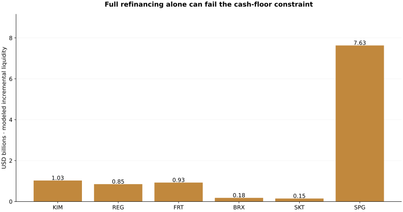

# Retail REIT Refinancing Resilience

**Decision-maker:** a retail-property REIT treasury / finance committee. **Objective:** determine the minimum common rollover share that preserves an assumed cash floor in every year of a disclosed five-year maturity ladder, and identify scenarios where rollover alone cannot do so.

This project combines original SEC maturity disclosures, explicit parent / operating-partnership scope reconciliation, a seven-year CFO history and an exact constrained cash-waterfall model. It supports a conditional financing discussion rather than an investment recommendation or lender approval.

## Findings

Six issuers disclose **$53.25 billion** of face principal in six maturity buckets, including **$31.23 billion due in 2026–2030** and **$8.71 billion in 2026**. All six pass the unchanged-CFO, full-rollover baseline. Across 90 persistent-shock scenarios, **37 cannot preserve the modeled cash floor using rollover alone**; no issuer passes every scenario. The sum of each issuer's worst-case modeled incremental liquidity gap is **$10.76 billion**, before financing that gap. This is a sum of standalone scenario requirements, not an estimate of today's sector funding deficit.

The initial 0–30% CFO-shortfall grid is challenged with a separate 40% level shock because the 36 observed annual CFO changes include a **38.90% decline**. One observed annual decline does not establish a five-year probability or duration. Under a 40% shortfall and 400bp incremental spread, **one of six** issuers becomes feasible when CFO recovers after two years, versus zero under five-year persistence. Duration matters alongside severity.



Read the [executive brief](outputs/executive_brief.md), [methodology](METHODOLOGY.md), [data dictionary](DATA_DICTIONARY.md), [candid assessment](CANDID_ASSESSMENT.md), [open issues](ISSUES.md), and [interview explanation, measured resume bullets and five answers](INTERVIEW.md).

## Data and workflow

The sample is KIM, REG, FRT, BRX, SKT and SPG. The common audited statement date is **December 31, 2025**; the annual filings were public in February 2026. Source selection is capped at October 20, 2026. These are dated annual disclosures, not current October treasury balances. The [source manifest](data/source_manifest.json) contains original SEC URLs and hashes; [pinned archives](data/pinned_archives.json) identify the supplied numerical snapshots.

There are 36 maturity buckets, 65 current lineage facts and 42 CFO observations for 2019–2025. SKT consistently uses its operating partnership, REG uses the listed parent, and KIM excludes the separate unconsolidated-JV mortgage schedule. Face principal is reconciled to the chosen book-debt measure with a retained basis bridge; a difference is not silently counted as a maturity payment.

Use Python 3.12 from the repository root:

```bash
python -m venv .venv-finance
.venv-finance/bin/python -m pip install -r projects/2026-10-20/requirements.txt
.venv-finance/bin/python projects/2026-10-20/verify_all.py
.venv-finance/bin/python projects/2026-10-20/serve.py --project retail-reit-refinancing-review
```

Visit `http://127.0.0.1:8767/app.html`. On Windows use `.venv-finance\Scripts\python.exe`. Keep the shared parent scripts with this project. The workbench also opens offline as `outputs/app.html` with sibling `workbench.js`; it lets an analyst select an issuer, stress CFO and incremental spread, compare persistent versus two-year shocks, set a planned rollover and inspect annual cash / shortfalls. It rejects invalid scenarios and clears stale results. GitHub publishes source files; this is not a hosted application.

The [shared reproduction guide](../README.md) documents ingestion, independent original-HTML audit and the three verification stages. `reit_pipeline.py` produces source-linked inputs, SQL maturity exposure, exact rollover frontiers, 450 annual persistent-scenario cash rows and 48 recovery-sensitivity rows. `presentation.py` builds the report and workbench.

## Verification and limits

[verification.json](verification.json) records archive, source-pointer, SQL and deterministic rebuild checks. Fourteen shared tests include hand-worked cash cases and **180 independently constructed SciPy/HiGHS reconciliations**. A separate CI job must pass 24 report/application cases across both projects, three browser engines and desktop/mobile viewports; screenshots and `results.json` are published only after actual success. Passing software checks does not validate a lender's covenants or a financing recommendation.

Capex, cash floors, issuance fees, shock duration and refinancing terms are explicit assumptions. Revolvers, property sales, equity issuance, covenant headroom, asset-level capex, tax-distribution constraints and future refinancing maturities are not available in this model. Actual financing action requires treasury diligence on these items. See [source and role research](../RESEARCH.md).
