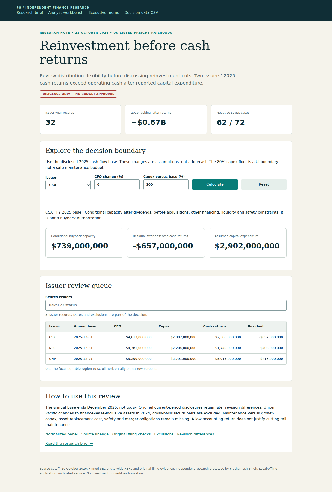

# Freight Rail Reinvestment & Cash Returns

**Test whether cash returns fit after reinvestment, before discussing capital cuts.**

Intended user: freight rail capital-allocation / treasury analyst. Independent research prototype by Prathamesh Singh; not employer work, investment advice or a claim of senior professional tenure.

## Start with the decision

**FY2025 CFO $18.264B − cash PP&E capex $8.897B − cash returns $10.032B = −$665M.** Two of three issuers have a negative specified cash residual. This does not identify debt-financed buybacks or justify cutting maintenance. Current treasury validation remains required.

Download/open [`outputs/app.html`](outputs/app.html) for the offline analyst workbench; use [`outputs/report.html`](outputs/report.html) for the visual brief with linked evidence. Read the [executive memo](outputs/executive_brief.md), [methods](METHODOLOGY.md), [data definitions](DATA_DICTIONARY.md), [candid assessment](CANDID_ASSESSMENT.md) and [interview guide](INTERVIEW.md).



## Reproduce

Requires Python 3.12 and the shared parent files in `projects/2026-10-21`. From repository root:

```bash
python -m pip install -r projects/2026-10-21/requirements.txt
python projects/2026-10-21/verify.py
python projects/2026-10-21/serve.py --port 8765
```

Open `http://127.0.0.1:8765/freight-rail-capital-review/outputs/app.html`. See the [shared setup/browser guide](../README.md) for clean-environment setup and actual browser commands. Source code publication is not live application hosting.

## Evidence and boundaries

32 admitted issuer-years with 256 numeric source operands. All three FY2025 records are coherent common-year inputs. Exact scenario arithmetic is checked independently using Decimal; source-specific SQL totals, three-year coverage, reverse stress and net/gross asset sensitivity remain auditable. UNP finance-lease asset scope is labeled and the transition return is excluded.

Observed filings, model outputs and user assumptions are separate. Three verification stages and browser evidence are described in [the shared guide](../README.md); the commit-specific CI run is the public record. Stage-3 output review includes actual browser screenshots. Physical-device, stakeholder and operational validation remain outside scope.

## Source and reuse

Original public [SEC Company Facts](https://www.sec.gov/search-filings/edgar-application-programming-interfaces), filing metadata and original-filing numeric cells, retrieved October 21, 2026, with filing cutoff **October 20**. Source URLs, hashes, accession/period/unit and JSON-pointer lineage are bundled. [Primary-source and employer research](../RESEARCH.md) explains selection. Numeric source data remain attributed; issuer-authored narratives are not redistributed. Original code is MIT licensed. No private resume, contact information or employer records are used.
