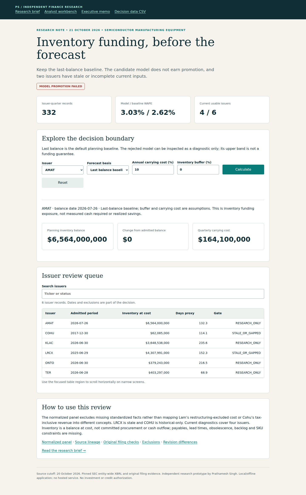

# Semiconductor Inventory Funding & Forecast Governance

**Reject an unearned forecast upgrade before changing an inventory funding plan.**

Intended user: semiconductor equipment treasury / FP&A analyst. Independent research prototype by Prathamesh Singh; not employer work, investment advice or a claim of senior professional tenure.

## Start with the decision

The candidate ridge model loses to the last-balance baseline: **3.03% vs 2.62% held-out WAPE**, across **47 outcomes**. Two of six issuers lack coherent current inputs. Promotion fails; retain the baseline and resolve source/operating evidence.

Download/open [`outputs/app.html`](outputs/app.html) for the offline analyst workbench; use [`outputs/report.html`](outputs/report.html) for the visual brief with linked evidence. Read the [executive memo](outputs/executive_brief.md), [methods](METHODOLOGY.md), [data definitions](DATA_DICTIONARY.md), [candid assessment](CANDID_ASSESSMENT.md) and [interview guide](INTERVIEW.md).



## Reproduce

Requires Python 3.12 and the shared parent files in `projects/2026-10-21`. From repository root:

```bash
python -m pip install -r projects/2026-10-21/requirements.txt
python projects/2026-10-21/verify.py
python projects/2026-10-21/serve.py --port 8765
```

Open `http://127.0.0.1:8765/semiconductor-inventory-funding/outputs/app.html`. See the [shared setup/browser guide](../README.md) for clean-environment setup and actual browser commands. Source code publication is not live application hosting.

## Evidence and boundaries

332 original-current issuer-quarter records, 1,160 numeric source operands and a 2022-only penalty selection precede calibration and 2024–2026 testing. Predictions obey actual filing-label availability. Independent SVD reconciliation checks every stored backtest prediction. Five test issuer clusters and incomplete standardized coverage limit inference. The admitted current inputs cover four issuers and $10.995B inventory; historical/stale balances are not summed as current.

Observed filings, model outputs and user assumptions are separate. Three verification stages and browser evidence are described in [the shared guide](../README.md); the commit-specific CI run is the public record. Stage-3 output review includes actual browser screenshots. Physical-device, stakeholder and operational validation remain outside scope.

## Source and reuse

Original public [SEC Company Facts](https://www.sec.gov/search-filings/edgar-application-programming-interfaces), filing metadata and original-filing numeric cells, retrieved October 21, 2026, with filing cutoff **October 20**. Source URLs, hashes, accession/period/unit and JSON-pointer lineage are bundled. [Primary-source and employer research](../RESEARCH.md) explains selection. Numeric source data remain attributed; issuer-authored narratives are not redistributed. Original code is MIT licensed. No private resume, contact information or employer records are used.
