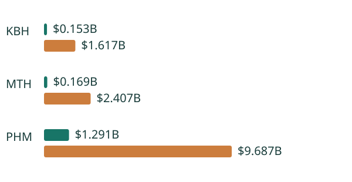

# Homebuilder Land Option Diligence

**Decision owner:** homebuilder land-acquisition committee and divisional finance. **Objective:** distinguish funded exposure, conditional purchase prices and balance-sheet scope before choosing whether to exercise, renegotiate or abandon a land option.

The empirical register covers **74 contract-scope/date records across PHM, MTH and KBH**, extracted from **24 original SEC filings**, with **185 source operands** and **48 exact category-total reconciliations**. The latest disclosed deposits and separately available pre-acquisition costs total **$1.613026B**; conditional remaining purchase prices total **$13.711157B**. These have different observation dates and definitions. The former is not a fully comparable maximum-loss estimate and the latter is not debt.

The substantive source finding is a scope trap: Meritage's 2021 committed subtotal includes a balance-sheet contract; adding the three off-balance-sheet committed categories gives the correct boundary. Its 2026 filing reuses a legacy refundable tag for an aggregate committed caption, so taxonomy names alone cannot establish refundability. PHM reports a remaining purchase price, while MTH and KBH report aggregate prices; deposits must not be subtracted twice.

The conditional decision layer compares immediate exercise/abandonment with one-year waiting using explicit net land values, states, probabilities, discounting and extension costs. It includes 243 scenarios and 27 refund sensitivities. It demonstrates that a sunk nonrefundable deposit does not justify an uneconomic additional acquisition. It does not estimate real option values or authorize a portfolio action.

## Setup and delivery

Python 3.12, using the confirmed Python/SQL toolset. From the repository root:

```bash
python -m venv .venv-oct22
.venv-oct22/bin/python -m pip install -r projects/2026-10-22/requirements.txt
.venv-oct22/bin/python projects/2026-10-22/verify.py
python -m http.server 8769 --bind 127.0.0.1 --directory projects/2026-10-22
```

On Windows use `.venv-oct22\Scripts\python.exe`. The shared parent scripts must be retained. Open `http://127.0.0.1:8769/homebuilder-land-option-diligence/outputs/app.html`, or open `outputs/app.html` directly. The application is self-contained and runs offline. The static report needs its sibling `decision_evidence.svg`. GitHub publishes source; no live hosted service is claimed.

[Executive report](outputs/report.html) · [Offline application](outputs/app.html) · [Executive brief](outputs/executive_brief.md) · [Observed panel](outputs/panel.csv) · [Source lineage](outputs/source_lineage.csv) · [Source manifest](data/source_manifest.json) · [Original-HTML audit](data/original_html_audit.json) · [Methodology](METHODOLOGY.md) · [Dictionary](DATA_DICTIONARY.md) · [Candid assessment](CANDID_ASSESSMENT.md) · [Issues](ISSUES.md) · [Interview defense](INTERVIEW.md).



## Three verification stages

1. Pin original SEC numerical snapshots, archive/content/HTML hashes and exact context/dimension/currency pointers. Reconcile source scope and declared precision. Original HTML operands were independently recalculated with Decimal before snapshot publication; offline CI verifies the matching recorded audit, not fresh recollection.
2. Hand-worked cases and separate independent calculations: enumerate all four land exercise/abandon policies in 243 cases; solve 216 hotel income-floor constraints by independent Decimal/bisection. Reconcile every panel operand, SQL aggregation and matched accounting identity.
3. Install pinned dependencies in a fresh environment, delete every output in an isolated copy and regenerate byte-identically. Actual browser acceptance separately exercises main flows, invalid/blank inputs, missing-source errors, empty searches, keyboard selection/submission, reset and scroll recovery, and desktop/mobile layouts across Chromium, Firefox and WebKit. Do not infer its pass from analytical tests: inspect the exact workflow result and screenshot artifact.

The source, method and software gates differ from the real-world decision gate, which remains withheld. The work is an independent research prototype, not employment, investment advice, professional certification or proof of a particular tenure.
