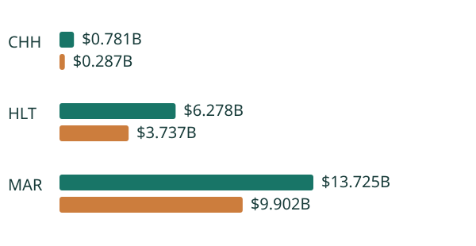

# Hotel Reimbursement Economics

**Decision owner:** hotel-management/franchising FP&A and corporate program-budget committee. **Objective:** reconcile reported income to the reimbursement business before ranking operating performance or approving additional program expense.

**34 issuer-period observations**, including **22 annual periods**, come from **12 original SEC filings** for MAR, HLT and CHH. The panel retains **199 exact original-source operands**, context-specific schema aliases, dated exclusions and a complete reported income/cost/gain/impairment identity. Each of six matched year-over-year bridges reconciles precisely; overlapping annual, half-year and quarter observations are never added together as a panel total.

Across the three issuers, H1 2026 reports **$20.784337B revenue**, including **$13.926228B reimbursement revenue**, with a **−$326.224M** reimbursement revenue-minus-expense balance. That is an accrual subtotal, not a current cash funding deficit. The denominator and numerator bridge changes H1 margin ordering: GAAP HLT > CHH > MAR becomes HLT > MAR > CHH when net reimbursement balances and reimbursement revenue are excluded. Neither ordering isolates pure fee profitability, because other business mix and costs remain.

A 216-case grid evaluates incremental program spending against explicit cost/recovery growth assumptions and management income floors. Twenty-six cases fall below their assumed floors; the grid is not a probability distribution or forecast. Historical reimbursable categories do not support a universal assumption of zero program margin.

## Setup and delivery

Python 3.12, using the confirmed Python/SQL toolset. From the repository root:

```bash
python -m venv .venv-oct22
.venv-oct22/bin/python -m pip install -r projects/2026-10-22/requirements.txt
.venv-oct22/bin/python projects/2026-10-22/verify.py
python -m http.server 8769 --bind 127.0.0.1 --directory projects/2026-10-22
```

On Windows use `.venv-oct22\Scripts\python.exe`. The shared parent scripts must be retained. Open `http://127.0.0.1:8769/hotel-reimbursement-economics/outputs/app.html`, or open `outputs/app.html` directly. The application is self-contained and runs offline. The static report needs its sibling `decision_evidence.svg`. GitHub publishes source; no live hosted service is claimed.

[Executive report](outputs/report.html) · [Offline application](outputs/app.html) · [Executive brief](outputs/executive_brief.md) · [Observed panel](outputs/panel.csv) · [Source lineage](outputs/source_lineage.csv) · [Source manifest](data/source_manifest.json) · [Original-HTML audit](data/original_html_audit.json) · [Methodology](METHODOLOGY.md) · [Dictionary](DATA_DICTIONARY.md) · [Candid assessment](CANDID_ASSESSMENT.md) · [Issues](ISSUES.md) · [Interview defense](INTERVIEW.md).



## Three verification stages

1. Pin original SEC numerical snapshots, archive/content/HTML hashes and exact context/dimension/currency pointers. Reconcile source scope and declared precision. Original HTML operands were independently recalculated with Decimal before snapshot publication; offline CI verifies the matching recorded audit, not fresh recollection.
2. Hand-worked cases and separate independent calculations: enumerate all four land exercise/abandon policies in 243 cases; solve 216 hotel income-floor constraints by independent Decimal/bisection. Reconcile every panel operand, SQL aggregation and matched accounting identity.
3. Install pinned dependencies in a fresh environment, delete every output in an isolated copy and regenerate byte-identically. Actual browser acceptance separately exercises main flows, invalid/blank inputs, missing-source errors, empty searches, keyboard selection/submission, reset and scroll recovery, and desktop/mobile layouts across Chromium, Firefox and WebKit. Do not infer its pass from analytical tests: inspect the exact workflow result and screenshot artifact.

The source, method and software gates differ from the real-world decision gate, which remains withheld. The work is an independent research prototype, not employment, investment advice, professional certification or proof of a particular tenure.
