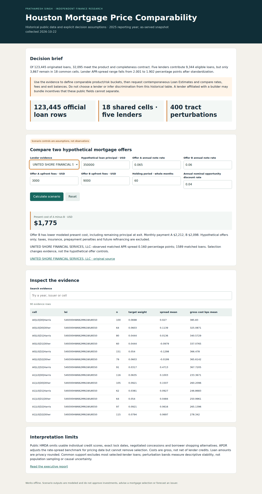
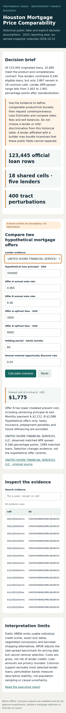

# Houston Mortgage Price Comparability

A public-data research workflow for determining which historical lender-price comparisons have observable common support, plus a separate hypothetical rate/fee/holding-period workbench.

By Prathamesh Singh · Independent portfolio research · Published source, **not a live hosted service**. Original data collected 2026-10-22; reporting/information timing is documented in METHODS.md.

Start with the [executive brief](EXECUTIVE_BRIEF.md), [candid assessment](CANDID_ASSESSMENT.md) and [five interview answers plus two measured resume bullets](INTERVIEW.md). The executive brief includes two plain-English paragraphs explaining what to understand and defend.

## Run the complete workflow

Requires Python 3.12, pinned dependencies and the shared sibling [`../energy-mortgage-toolkit/`](../energy-mortgage-toolkit/). Clone the full repository; this folder alone intentionally does not duplicate the shared code.

From repository root:

```bash
python -m venv /tmp/portfolio-finance-venv
/tmp/portfolio-finance-venv/bin/python -m pip install -r projects/2026-10-22/energy-mortgage-toolkit/requirements.txt
/tmp/portfolio-finance-venv/bin/python projects/2026-10-22/energy-mortgage-toolkit/verify.py
```

The Windows equivalent uses the environment's `Scripts/python.exe`. Pinned source data are included; no network/API credentials are required for analysis. To intentionally regenerate outputs, run the shared `mortgage.py`, then `presentation.py`. `verify.py` compares committed outputs before rebuilding them in an empty temporary directory; unexpected drift fails.

Open [`outputs/app.html`](outputs/app.html) directly in a browser, or download this repository and double-click that file. The self-contained application works offline. [`outputs/report.html`](outputs/report.html) and [`outputs/chart.svg`](outputs/chart.svg) are the executive report and figure. GitHub's source page does not render them as a hosted app. CSV outputs open in Excel; [`warehouse.sql`](warehouse.sql) contains the grouping query executed against the pipeline's in-memory SQLite tables.

## Evidence and methods

- [Methods, assumptions, information timing and adoption gate](METHODS.md).
- [Raw/derived/model data dictionary, source rights and lineage](DATA_DICTIONARY.md); [`data/source_manifest.json`](data/source_manifest.json).
- [Primary-source industry and official-employer research](../energy-mortgage-toolkit/RESEARCH.md), with checked date and inaccessible-posting limitations.
- [Executed original-source audit](../energy-mortgage-toolkit/source_audit.json) and [three-stage analytical/reproduction record](../energy-mortgage-toolkit/verification.json).
- [Actual browser acceptance script and setup](../energy-mortgage-toolkit/README.md); [GitHub Actions](https://github.com/Pratattack/analytics-portfolio/actions/workflows/mortgage-energy.yml) runs all three engines on desktop/mobile, including invalid, empty, missing-source, keyboard, recovery and mathematical reconciliation flows. Permanent evidence is released for the exact main commit after both jobs pass, under `mortgage-energy-2026-10-22-<commit-prefix>`.

## Screenshots from executed Chromium acceptance





[Desktop executive report screenshot](screenshots/desktop-report.png). Screenshots are browser evidence, not a design mockup. Full cross-engine evidence is retained by CI and the commit-specific release. The report chart can scroll horizontally on mobile; financial evidence tables scroll locally.
