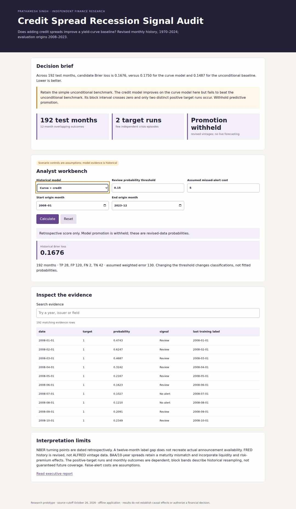
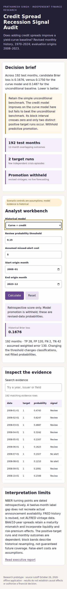

# Credit Spread Recession Signal Audit

**Question:** do credit spreads add reliable predictive value beyond a Treasury-curve model and a simple historical recession probability? **Decision owner:** credit-research model governance. **Result:** withhold model promotion.

The project covers 648 research-panel months, evaluates 192 held-out origins and preserves overlapping-target dependence. The candidate's Brier loss is **0.1676**, versus **0.1750** for the curve model and **0.1487** for the unconditional baseline. Credit information improves one comparison but fails the simplest benchmark. The paired 24-month block band crosses zero, and the test contains only two positive target runs.

Advanced components are expanding-window estimation with a twelve-month label gap, training-only transformations, a separate model/threshold-selection window, paired block sensitivity, independent objective/gradient and SQL checks, and an offline review-threshold workbench. Revised source vintages and delayed NBER labels block real-time claims. No current recession prediction, trading result or causal conclusion is offered.

[Executive brief](EXECUTIVE_BRIEF.md) · [Methods/data definitions](METHODS.md) · [Sources](SOURCES.md) · [Interview guide and resume bullets](INTERVIEW.md) · [Issue register](ISSUES.md)

## Reproduce and inspect

From repository root, Python 3.12:

```bash
python -m venv /tmp/finance-oct26
/tmp/finance-oct26/bin/python -m pip install -r projects/2026-10-26/research-toolkit/requirements.txt
/tmp/finance-oct26/bin/python projects/2026-10-26/research-toolkit/verify.py
```

On Windows use the venv's `Scripts/python.exe`. Open `outputs/report.html` or `outputs/app.html` directly. Both are self-contained offline files; GitHub source publication does not host a live service.

Actual browser acceptance (Node 22):

```bash
npm install --prefix /tmp/finance-browser playwright@1.56.1
/tmp/finance-browser/node_modules/.bin/playwright install --with-deps chromium firefox webkit
NODE_PATH=/tmp/finance-browser/node_modules node projects/2026-10-26/research-toolkit/browser_test.cjs
```

The shared toolkit is implementation infrastructure, not an additional portfolio project. CI repeats clean installation, twelve analytical/source tests, empty-output reproduction and 24 engine/viewport/surface browser cases. Tests and actual results are separate: `verification.json` certifies analytical checks; the browser evidence release certifies executed browser cases. Screenshots and browser evidence are linked from the root portfolio README after acceptance.

## Executed Chromium previews




