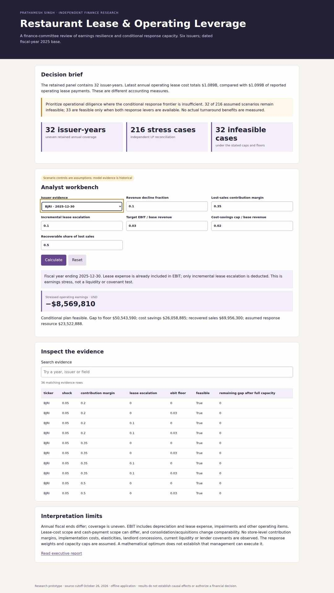
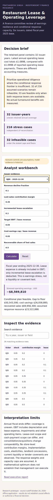

# Restaurant Lease & Operating Leverage Review

**Decision:** which earnings stresses exceed a restaurant group's assumed response capacity, and what evidence is needed before approving a response? **Users:** corporate finance and operating committees.

A source-linked panel retains **32 issuer-years across six operators**. The latest original filings reconcile **24 source facts**. Their selected FY2025 operating lease expenses total **$1.089B**, versus **$1.099B** in lease payments; fiscal ends and accounting scopes differ. Base rent is already in EBIT, so stress deducts only incremental escalation.

The conditional response frontier independently reconciles **216 scenarios** against HiGHS. **32 remain infeasible**, while **33 require both response levers** under the selected caps. Seventy-two cap/recovery sensitivities and 23 historical adjacent-year challenges expose fragility. These are assumed scenarios, not observed savings, current funding deficits or lender covenant results.

The advanced work is in same-accession observation controls, original-context reconciliation, accounting-scope boundaries, exact bounded optimization, independent validation and a usable assumptions workbench. The model cannot substitute for store-level operating evidence.

[Executive brief](EXECUTIVE_BRIEF.md) · [Methods/data definitions](METHODS.md) · [Sources](SOURCES.md) · [Interview guide and resume bullets](INTERVIEW.md) · [Issue register](ISSUES.md)

## Reproduce and inspect

From repository root, Python 3.12:

```bash
python -m venv /tmp/finance-oct26
/tmp/finance-oct26/bin/python -m pip install -r projects/2026-10-26/research-toolkit/requirements.txt
/tmp/finance-oct26/bin/python projects/2026-10-26/research-toolkit/verify.py
```

On Windows use the venv's `Scripts/python.exe`. Open `outputs/report.html` or `outputs/app.html` directly. Both are self-contained offline files; GitHub source publication does not host a live service.

Actual browser acceptance (Node 22):

```bash
npm install --prefix /tmp/finance-browser playwright@1.56.1
/tmp/finance-browser/node_modules/.bin/playwright install --with-deps chromium firefox webkit
NODE_PATH=/tmp/finance-browser/node_modules node projects/2026-10-26/research-toolkit/browser_test.cjs
```

The shared toolkit is implementation infrastructure, not an additional portfolio project. CI repeats clean installation, twelve analytical/source tests, empty-output reproduction and 24 engine/viewport/surface browser cases. Tests and actual results are separate: `verification.json` certifies analytical checks; the browser evidence release certifies executed browser cases. Screenshots and browser evidence are linked from the root portfolio README after acceptance.

## Executed Chromium previews




